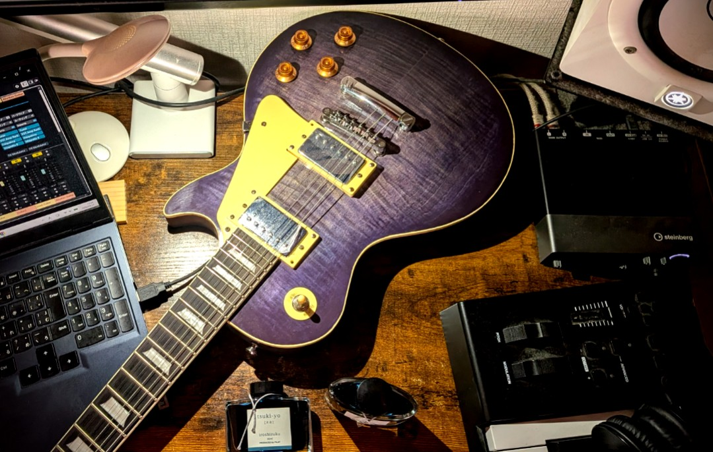
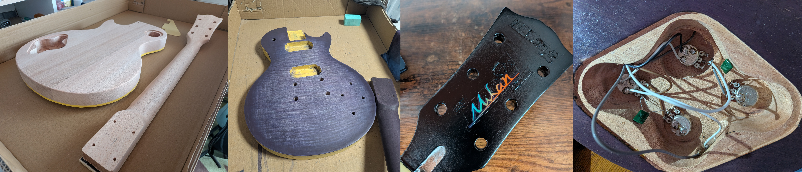

> **Note:** This repository primarily serves as a personal record of my guitar-building experience.

# 🎸 Custom Les Paul Guitar

This project documents the process of building a custom electric guitar using a Les Paul-style DIY guitar kit, including sanding, painting, logo design, electronics, and final assembly.

The project took approximately two months to complete. My goal was to gain a deeper understanding of guitar construction and how electric guitars produce sound through hands-on experience, from customizing the design to completing the instrument.

This repository contains notes on the techniques, challenges, and lessons learned throughout the process. Detailed instructions, materials, and additional notes for each stage are available in the [`docs/`](docs/) directory (written in Japanese).

## 💡 Background & Motivation

As someone who regularly plays guitar and composes music, I wanted to better understand how guitars are constructed and how their components contribute to sound production.

In particular, I was interested in learning how materials, finishes, and electronic components affect an instrument's characteristics, and how this knowledge could be applied to my own performances and music production.

Another goal was to gain experience managing a long-term project, planning and completing each stage while balancing it with my daily activities and other commitments.

Additionally, I hoped that the experience of designing, customizing, and building my own instrument would be valuable for my other creative projects, such as illustration, music production, and application development.

## 🛠️ Build Process

For this project, I used a Les Paul-style DIY guitar kit featuring a flame maple top and a mahogany body.

The guitar was completed through the following stages:

0. **Wood Cutting**  
   This step was not necessary, as the wooden components were already cut and shaped.

1. **Preparation — Sanding & Surface Preparation**  
   Sanded the body and neck to prepare the surfaces for painting, and applied masking tape to protect areas that did not require finishing.

2. **Coloring — Staining & Painting**  
   Applied a black stain to enhance the wood grain, followed by a custom purple stain created by mixing red and blue. Sanding between stages helped refine the final appearance.

3. **Finishing — Surface Coating & Polishing**  
   Applied multiple layers of a curing oil finish, followed by sanding and polishing to achieve a smooth surface.

4. **Headstock & Logo — Custom Design**  
   Painted the headstock black and applied an original logo using a waterslide decal. The decal was embedded between layers of the finish to create a seamless appearance.

5. **Assembly & Electronics — Wiring & Final Setup**  
   Installed the neck and hardware, soldered the pickups and control circuits, and completed the final adjustments, including intonation tuning.

## 🎨 Design & Challenges

### Color & Finish

For the guitar's appearance, I wanted to create a distinctive combination of purple coloring and the natural grain patterns of flame maple.

By applying black and purple stains in stages, with sanding between applications, I adjusted the contrast and color distribution to bring out the character of the wood grain.

I also chose a black headstock with an original logo, paying attention to the overall visual balance and consistency of the guitar's design.

### Trial & Error

As this was my first guitar-building project, I encountered several challenges, particularly during the sanding and finishing stages.

For example, excessive sanding removed more of the finish than intended, requiring me to purchase additional finishing materials. Some stages also took longer than originally planned.

These experiences taught me the importance of preparing extra materials, estimating the time required for each stage, and adjusting the process based on the actual results rather than strictly following the initial plan.

## 🌱 Results & Learnings

Through this project, I gained a deeper understanding of guitar construction, electronic circuits, painting, and surface finishing techniques.

In particular, experiencing the time and effort required to achieve a high-quality finish gave me a greater appreciation for the craftsmanship behind commercial guitars and custom-built instruments.

I also acquired practical knowledge that I can apply to maintaining and customizing my other guitars.

Beyond the technical aspects, completing the entire project gave me valuable experience in planning and managing a creative project from start to finish. It also helped me appreciate both the challenges and the satisfaction of taking responsibility for creating something of my own.

## 📚 Documentation

Detailed notes on the materials, tools, procedures, and precautions for each stage are available in the following documents.

*The documentation is currently written in Japanese.*

| Document | Description |
|---|---|
| [01 — Painting](docs/01_painting.md) | Surface preparation, sanding, staining, oil finishing, and polishing |
| [02 — Headstock/Logo](docs/02_head_logo.md) | Headstock painting, original logo design, and waterslide decal application |
| [03 — Electronics/Wiring](docs/03_electronics.md) | Electronic components, wiring, soldering, and final testing |

## 🔗 References

The following resources were used as references during the project:

- **DIY Guitar Kit:** [Flame Maple Les Paul-Style DIY Guitar Kit — RockMusic](https://store.rockmusic.la/diy_guitar_lespaul_flamemaple_bolton/)
- **Wiring Diagram:** [Electric Guitar Wiring Diagrams — Frontisland CustomGuitarWorks](https://frontisland.com/reference-book/wiring-diagram/)

Additional references for individual stages are listed in the corresponding documentation files.