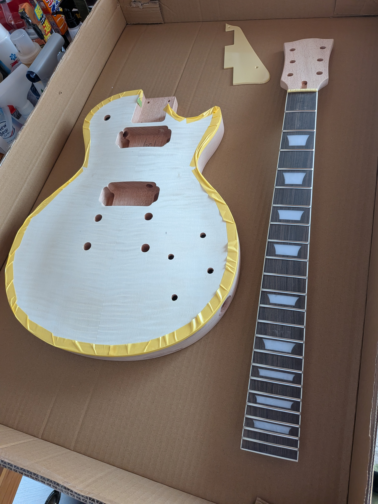
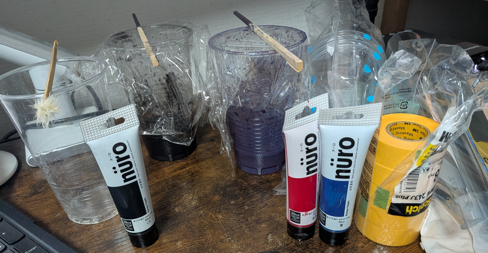
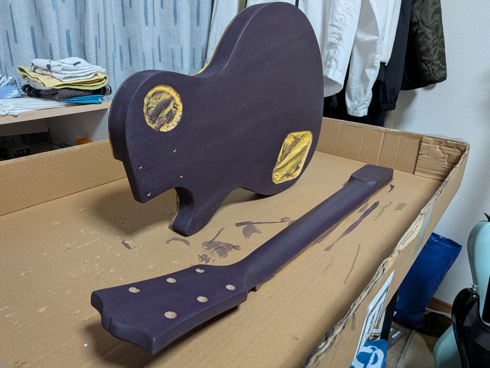
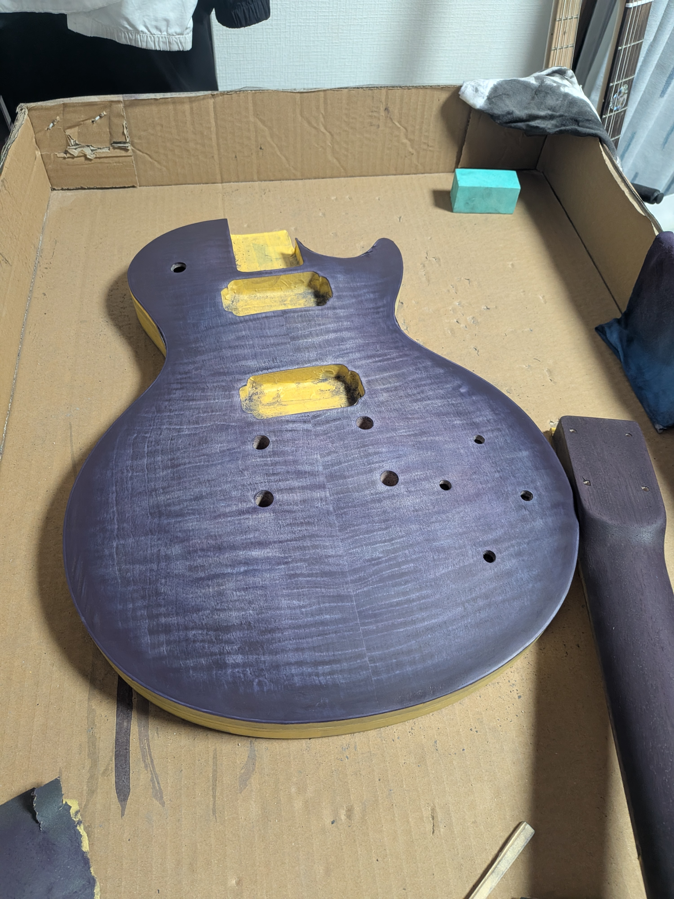
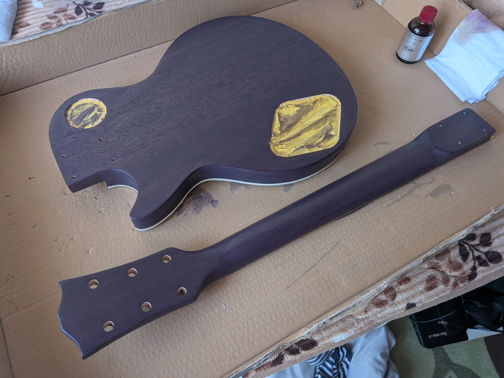
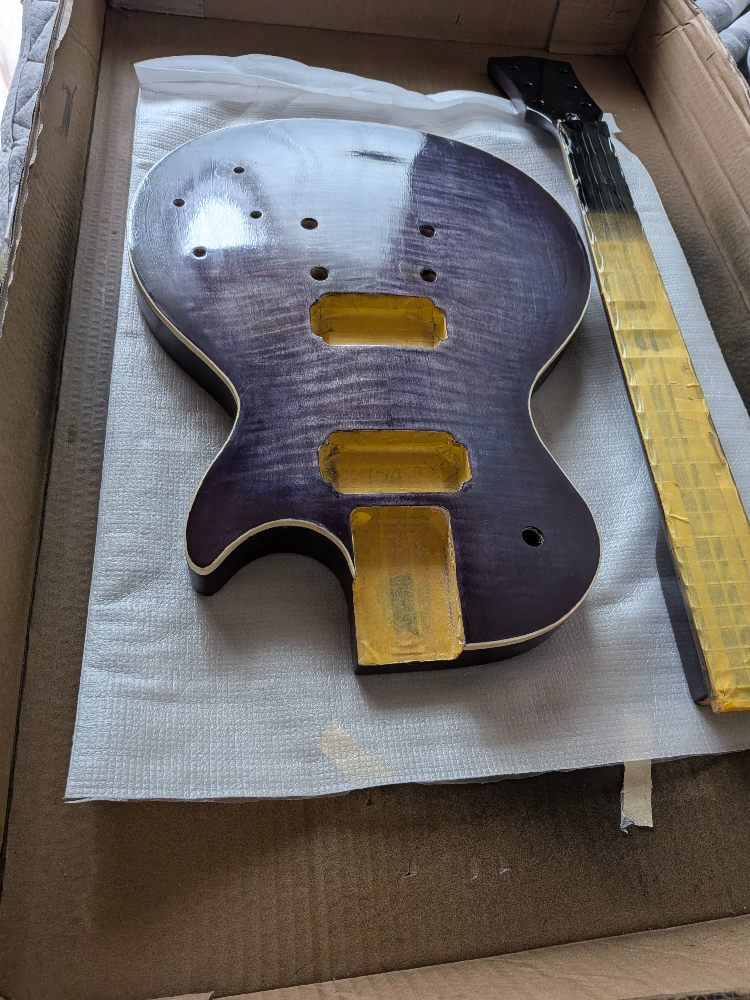
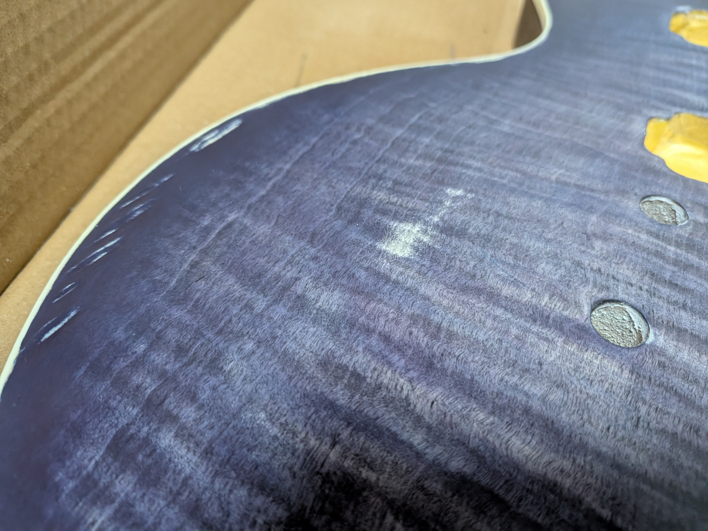

# 01 — Painting & Finishing

レスポールタイプのDIYギターキットを使用した、塗装・表面仕上げの作業記録です。

このドキュメントでは、下処理と研磨、水性塗料による着色、Xotic Oil Gelを用いた表面仕上げについて、実際に行った手順と注意点をまとめています。

> **Note:** 個人製作時の備忘録です。記載している番手や塗装回数は実際に使用したものであり、すべての木材や塗料に適した方法とは限りません。再現する場合は、使用製品の説明書も確認してください。

## 1. Materials & Tools

### 1.1 木材

| 部位 | 木材 |
|---|---|
| ボディトップ | フレイムメイプル |
| ボディサイド・バック | マホガニー |
| ネック | マホガニー |
| 指板 | ローズウッド |

今回は切り出し・成形済みのDIYギターキットを使用したため、木材の切削加工は行っていません。

### 1.2 研磨材

| 用途 | 使用した研磨材 |
|---|---|
| 塗装前の下地処理 | サンディングシート #400、#600 |
| 下地の仕上げ・毛羽取り | 3M スポンジ研磨材 #800〜1000相当 |
| 着色後・オイル塗装途中の研磨 | 3M スポンジ研磨材 #1200〜1500相当 |
| 鏡面仕上げ | #1200〜1500、#2000、#3000 |
| 最終研磨 | コンパウンド 7500（約1〜2μm）、9800（約0.5〜1μm） |

スポンジ研磨材は曲面にも追従しやすく、塗装面を軽く整える用途に適していました。

特にオイル塗装後は塗膜を削りすぎる可能性があるため、通常のサンディングシートよりもスポンジ研磨材を中心に使用しました。

### 1.3 塗料・仕上げ材

| 用途 | 使用材料 |
|---|---|
| 木目の強調（Grain Popping） | nüro系水性塗料・黒（グレーになる程度に希釈） |
| ボディの着色 | nüro系水性塗料・赤、青 |
| ボディバック・ネックの着色 | 黒色の水性塗料 |
| オイルフィニッシュ | Xotic Oil Gel |

今回はXotic Oil Gelを塗り重ねて保護層を作る方法を採用したため、別途シーラーやクリアラッカー、ウレタントップコートは使用していません。

### 1.4 その他の道具

- 紙コップ：塗料の混合・希釈
- ウエス：塗料やXotic Oil Gelの塗布。綿100%の布が望ましい
- マスキングテープ：指板やピックアップ取り付け部分などの保護
- サンディングブロック：平面の研磨
- 水・拭き取り用の布：毛羽立たせ処理や研磨粉の除去
- 保護手袋など：塗料の取り扱い時に使用

## 2. Preparation — 下処理・研磨

塗装前に木材表面を整え、塗料の吸収や仕上がりに大きなムラが生じないようにします。

### 2.1 マスキング

着色・塗装しない部分をマスキングテープで保護します。

特に、ローズウッド指板やピックアップ取り付け部分など、塗料を付着させたくない場所を保護しました。

### 2.2 下地研磨

ボディトップのフレイムメイプルと、それ以外のマホガニーでは、研磨の強さを少し変えて作業しました。

**ボディトップ（フレイムメイプル）**

1. #400のサンディングシートで表面を整える。
2. #600で細かい傷を減らす。
3. #800〜1000相当のスポンジ研磨材で軽く仕上げる。

**ボディバック・サイド・ネック（マホガニー）**

1. #400のサンディングシートで表面を整える。
2. #600で研磨する。
3. #800〜1000相当のスポンジ研磨材で仕上げる。

**注意点**

- 研磨しすぎると表面が滑らかになりすぎ、塗料の浸透や発色が変化する可能性があります。
- 特にフレイムメイプルでは、研磨の程度によって木目の見え方が変化するため、#800以降は実物を確認しながら判断するのが良いと感じました。
- 角や曲面は削りすぎやすいため、平面と同じ力で研磨しないようにします。

### 2.3 毛羽立たせ・毛羽取り

下地研磨の後、塗装前に毛羽取りを行いました。

木材に水分を与えると、表面の木繊維が毛羽立つことがあります。これを事前に取り除いておくことで、塗装時の表面のざらつきを抑えることを狙いました。

**手順**

1. 木材の表面を軽く水拭きする。
2. 十分に乾燥させる。
3. #800〜1000相当のスポンジ研磨材で、毛羽立った部分を軽く整える。
4. この処理を2回繰り返す。

この段階では、木材を削るというよりも、**立ち上がった繊維を倒すイメージ**で作業しました。

研磨材を表面に軽く当て、1〜2往復程度で済ませます。力を入れすぎないことが重要です。

## 3. Coloring — 着色・塗装

今回は、フレイムメイプルの木目を活かした紫色のボディを目指しました。

着色は大きく2段階に分けています。

1. 黒色を薄めたグレーによるGrain Popping
2. 赤色と青色を混ぜた紫色による着色

### 3.1 Grain Popping — 木目の強調

フレイムメイプルの木目を強調するため、最初に黒色の水性塗料を薄いグレーになる程度に希釈して塗布しました。

その後、木目の凹凸による色の残り方を利用し、立体感のある見た目を目指しました。

**手順**

1. 黒色の塗料を水で希釈し、薄めのグレーを作る。
2. ボディトップに塗布する。
3. 乾燥させる。
4. #1200〜1500相当のスポンジ研磨材で、表面の色を軽く落とす。

研磨では、木目の谷や色が残りやすい部分を意識し、それ以外の着色を落とすことで、木目のコントラストを強調しました。

**注意点**

色を落としすぎると木目の強調効果が弱くなるため、少しずつ研磨して状態を確認します。

### 3.2 Purple Staining — 紫色への着色

次に、赤色と青色の水性塗料を混合して紫色を作り、着色しました。

**塗料の配合**

- 赤：青 = 1：1
- ボディトップでは水で少し希釈
- ボディバック・ネックでは比較的濃い状態で使用

**手順**

1. 赤色と青色を同量混合して紫色を作る。
2. 必要に応じて水で希釈する。
3. ウエスで木材に塗布する。
4. 乾燥させる。
5. 色の濃さを確認し、再度塗布する。
6. これを合計3〜7回程度繰り返す。

重ね塗りによって色の濃さを調整し、一度に濃い色を作ろうとしないようにしました。

### 3.3 Burst Finish — グラデーションの表現

ボディトップでは、中心部と外周部の濃淡を変えるバースト風の仕上げを目指しました。

一般的なスプレー塗装ではなく、ステインの塗布と研磨を繰り返すことで、擬似的なバーストを作っています。

**手順**

1. 薄めの紫色を塗布する。
2. 乾燥させる。
3. 軽く研磨して色の濃淡を調整する。
4. 再び紫色を塗布する。
5. 少しずつ濃淡の差を作る。

一度大まかに塗り分けてから研磨だけでグラデーションを作るのは難しいと考え、塗布と研磨を交互に行う方法を採用しました。

**反省点**

ボディトップ以外では、色を薄めすぎる必要はなかったと感じました。

nüroは原液のまま塗りやすい製品でもあるため、次回は使用する製品の特性を確認した上で、バックやネックには原液の使用も検討したいと思います。

## 4. Finishing — オイルフィニッシュ

着色後は、Xotic Oil Gelを使って木材表面を仕上げました。

Xotic Oil Gelは、塗布後に硬化して塗膜を形成できる仕上げ材です。

今回は、ボディトップでは鏡面に近い光沢のある仕上がりを、それ以外の部分では比較的薄い仕上がりを目指しました。

### 4.1 Xotic Oil Gelの塗布

**実際の塗布回数**

| 部位 | 塗布回数 |
|---|---|
| ボディトップ | 合計20回 |
| ボディバック・サイド | 合計6回 |
| ネックなど | 合計6回 |

塗布にはウエスを使用し、木目に沿って薄く塗り広げました。

当時は各回の間に最低2時間の乾燥時間を設けていました。ただし、製品の使用案内には約4時間の塗り重ね間隔を推奨するものもあるため、再製作時は塗布量や温湿度も考慮して十分な乾燥時間を確保する必要があります。

また、表面が乾いて見えることと、塗膜が十分に硬化していることは異なるため、研磨前には特に注意が必要です。

### 4.2 中間研磨

一定回数の塗布後、表面の塗りムラを整えるために研磨を行いました。

- **ボディトップ：** 10回塗布した後に研磨
- **それ以外：** 6回塗布した後に研磨

研磨には#1200〜1500相当のスポンジ研磨材を使用しました。

Xotic Oil Gelの塗膜は想像以上に削れやすいため、強い力をかけず、表面の凹凸を軽く整える程度に留めます。

なお、参考資料では#800〜1000相当のスポンジ研磨材による軽い研磨も紹介されていますが、初心者の場合は細かい番手から試した方が塗膜を削りすぎる危険を抑えられると感じました。

### 4.3 追加塗布

ボディトップでは、中間研磨の後にXotic Oil Gelをさらに10回重ね塗りし、合計20回としました。

ヘッドトップについては、オリジナルロゴのデカールを配置する工程を挟んで追加塗布を行っています。

ロゴの制作・貼り付けについては、[02 — Headstock & Logo](02_head_logo.md) に記載します。

## 5. Polishing — 鏡面仕上げ

ボディトップでは、オイルフィニッシュ後にスポンジ研磨材とコンパウンドを使用し、光沢のある表面を目指しました。

### 5.1 研磨

以下の順番で研磨しました。

1. #1200〜1500相当のスポンジ研磨材
2. #2000
3. #3000

細かい番手へ段階的に移行し、表面の凹凸や研磨傷を減らしていきます。

ただし、研磨を強くかけると、せっかく形成した塗膜を削り取ってしまいます。

今回の製作では、Xotic Oil Gelを20回重ね塗りしていたにもかかわらず、研磨によって一部の着色が落ちてしまいました。

この経験から、塗膜を完全に平滑にすることだけを目標にせず、残っている塗膜の厚さを意識して作業する必要があると感じました。

### 5.2 コンパウンド

研磨後、コンパウンドを使用して表面に光沢を出しました。

使用したコンパウンドは以下の2種類です。

1. **7500（約1〜2μm）**：細かな研磨傷の除去
2. **9800（約0.5〜1μm）**：最終的な光沢仕上げ

ピカールなどの比較的粗い研磨剤の使用も検討できますが、今回の工程では必須ではないと判断しました。

### 5.3 研磨時の失敗と注意点

今回の鏡面仕上げでは、研磨後に白い斑点状の跡が残る部分がありました。

これらを完全になくそうとして研磨を続けた結果、一部で塗膜や着色を削りすぎてしまいました。

一方、コンパウンドで仕上げると、細かな白い跡は目立ちにくくなる場合がありました。

そのため、次回は以下の点に注意したいと思います。

- 白い斑点を完全になくすことにこだわりすぎない。
- 研磨を続ける前に、小さな範囲でコンパウンドの仕上がりを試す。
- 特に角や曲面は塗膜を削りすぎないようにする。
- 塗膜が薄くなっている場合は、研磨を続けるよりも再塗装を検討する。
- 使用するコンパウンドの粗さや、塗膜との相性も確認する。

なお、コンパウンドによって白い跡が目立たなくなっても、削り取られた塗膜や着色が元に戻るわけではありません。

## 6. Notes & Lessons Learned

今回の製作を通して、特に次の点が重要だと感じました。

### 研磨は削りすぎないことが重要

下処理では木材の表面を整えることが目的ですが、塗装後の研磨では塗膜を残しながら表面の凹凸を整える必要があります。

特にXotic Oil Gelは、細かい番手の研磨材でも塗膜が削れるため、慎重に作業することが重要でした。

### 着色は段階的に調整する

フレイムメイプルの木目や紫色のバーストを表現するため、一度に濃い色を作るのではなく、塗布・乾燥・研磨を繰り返す方法が有効でした。

一方で、色を薄めすぎると塗布回数が増えるため、木材や塗装箇所に応じて濃度を調整することも重要です。

### 材料と作業時間には余裕を持つ

今回、研磨による塗膜の削りすぎなどが原因で、Xotic Oil Gelの使用量が当初の想定を超え、追加購入が必要になりました。

初めての製作では、予想外の失敗や工程のやり直しも考慮し、材料や作業時間に余裕を持った計画を立てることが大切だと感じました。

### 塗料の取り扱い

研磨粉じんへの対策、換気、手袋の着用など、使用材料に応じた安全対策が必要です。

特にオイル系仕上げ材では、塗料が染み込んだウエスの取り扱いと廃棄方法にも注意し、製品の安全上の指示に従います。

## 7. References

1. こじたむにきけ, **「【最短で最大満足を追求】ギター塗装：素人の迷いポイント、失敗しないための重要ポイントをめちゃ丁寧に解説。」**  
   YouTube  
   https://www.youtube.com/watch?v=poKA81vDz-c

2. Project JAZZCASTER - by カバ野郎, **「ネックをXotic Oil Gel で塗装 その2 仕上げ編」**  
   https://www.jazzcaster.com/jazzcaster/xotic-oil-gel-finish/