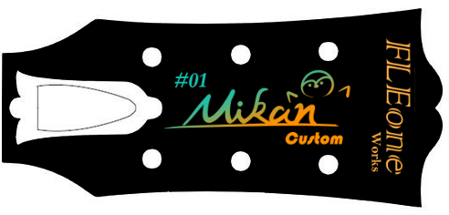
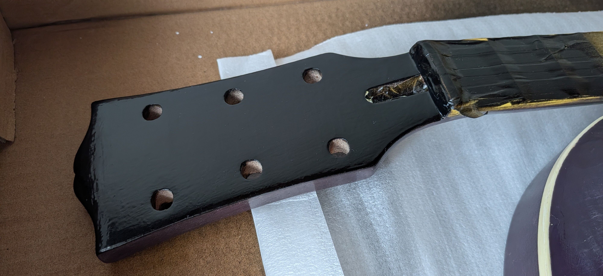
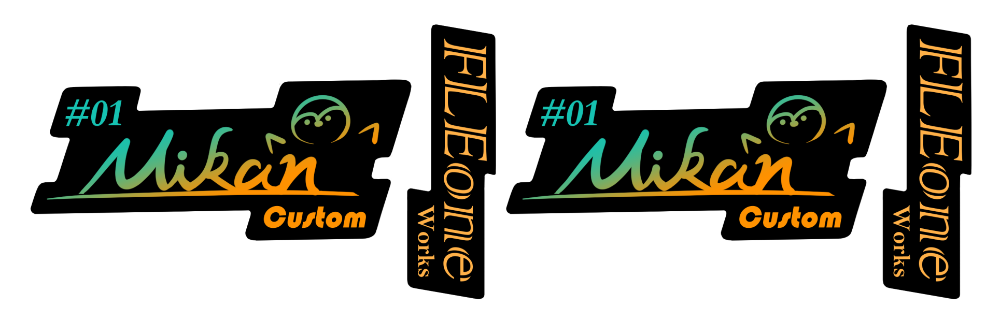
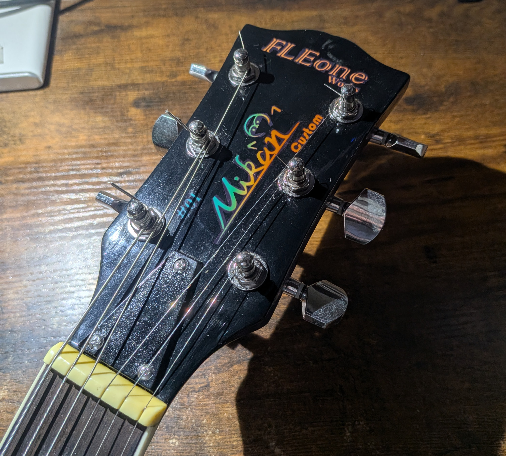

# 02 — Headstock & Logo

レスポールタイプのギターにおける、ヘッドの塗装とオリジナルロゴの制作記録です。

ヘッドは伝統的なGibson Les Paulのデザインを参考に黒色で仕上げ、オリジナルロゴを水転写デカールで配置しました。

## 1. Materials & Tools

| 用途 | 使用材料・ツール |
|---|---|
| ヘッドの塗装 | 黒色ニトロセルロースラッカー |
| ロゴのデザイン | CLIP STUDIO PAINT |
| ロゴの印刷・転写 | 水転写デカール |
| 表面仕上げ | Xotic Oil Gel |
| 最終研磨 | スポンジ研磨材、コンパウンド |

## 2. Logo Design — ロゴ制作

ロゴは、CLIP STUDIO PAINTを使用してオリジナルデザインを制作しました。

自分のアイコンとして使用している「みかん」をモチーフとし、オレンジ色を基調としたデザインにしています。

黒色のヘッドとのコントラストも意識し、シンプルながらも自分らしさのあるロゴを目指しました。

ロゴの編集可能なPSDファイルは、このリポジトリ内で公開しています。

## 3. Headstock Painting — ヘッド塗装

ヘッド部分は、伝統的なGibson Les Paulの外観を参考に、黒色のラッカーで塗装しました。

ボディはフレイムメイプルの木目を活かした紫色に仕上げていますが、ヘッドはあえて黒色にすることで、クラシックなレスポールらしさを残しています。

塗装後は、ロゴを配置するための下地を整えました。

## 4. Decal Application — デカールの貼り付け

制作したロゴを水転写デカールに印刷し、ヘッドに貼り付けました。

デカールの段差を目立たなくするため、Xotic Oil Gelの塗膜の間にデカールを埋め込む方法を採用しました。

**作業手順**

1. 黒色に塗装したヘッドにXotic Oil Gelを重ね塗りし、下地を作る。
2. 表面を整え、デカールを貼り付ける。
3. デカールを十分に乾燥させる。
4. デカールの上からXotic Oil Gelを追加で重ね塗りする。
5. 塗膜を十分に硬化させた後、研磨とコンパウンドで表面を仕上げる。

この方法により、ロゴが表面に貼られているだけではなく、塗膜の内部に収まったような仕上がりを目指しました。

研磨ではデカールまで削ってしまわないよう、塗膜の状態を確認しながら慎重に作業しました。

Xotic Oil Gelによる塗装や研磨の詳細については、[01 — Painting](01_painting.md) に記載しています。

## 5. Final Result — 完成

黒色のヘッドにオレンジ色のオリジナルロゴを組み合わせることで、伝統的なレスポールの雰囲気を残しながら、自分らしいデザインに仕上げることができました。

また、水転写デカールを塗膜の間に埋め込むことで、表面の一体感も意識しました。

## 6. References

- [01 — Painting & Finishing](01_painting.md) — Xotic Oil Gelを使用した塗装と表面仕上げの記録