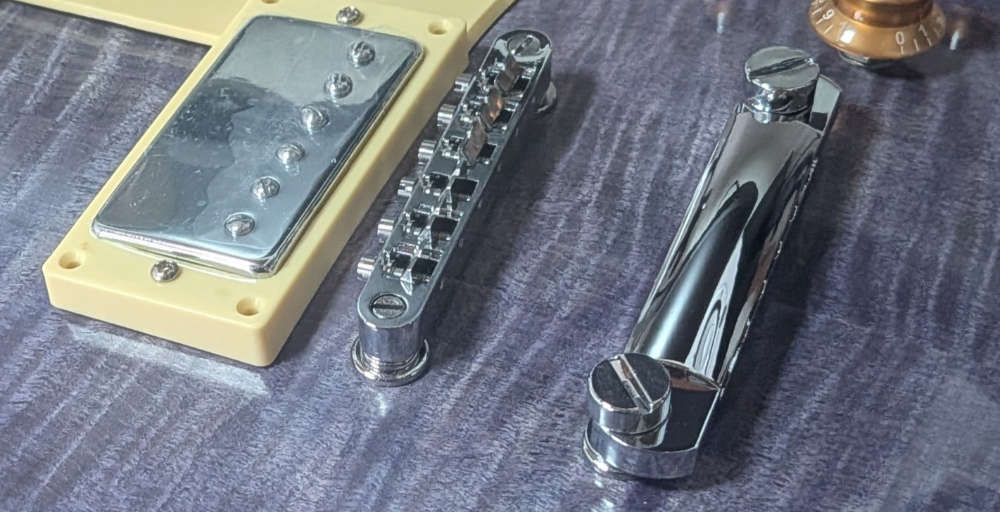
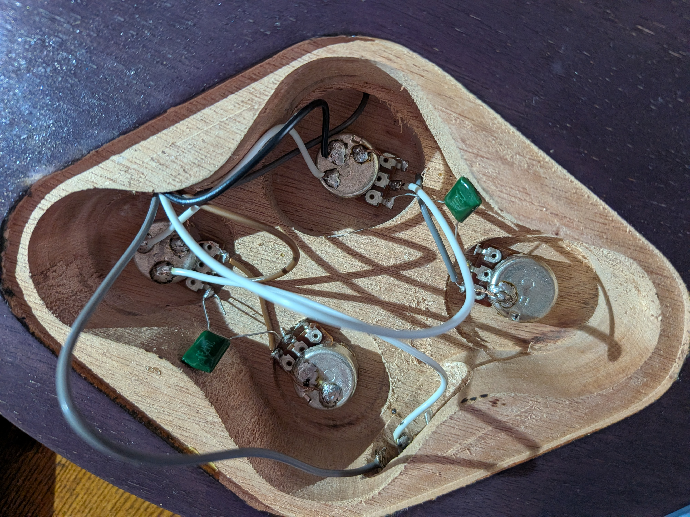
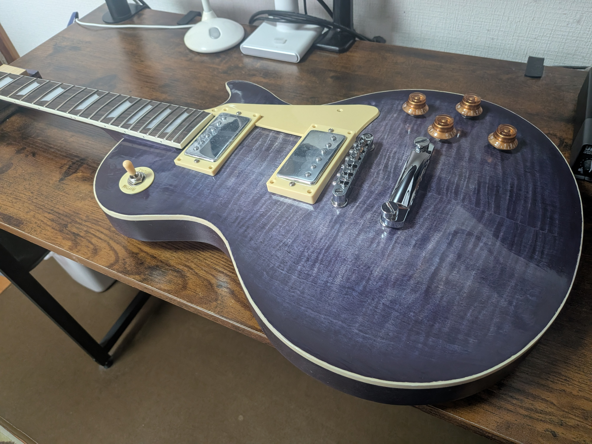

# 03 — Electronics & Assembly

レスポールタイプのギターにおける、電子部品の配線とパーツの組み立て、最終調整の作業記録です。

電装部分は一般的なレスポールの配線図を参考に、各パーツをはんだ付けして組み立てました。

## 1. Materials & Tools

| 用途 | 使用材料・工具 |
|---|---|
| 電子部品 | ピックアップ、ポット、トグルスイッチ、コンデンサ、アウトプットジャック |
| 配線 | リード線、GND線、はんだ |
| はんだ付け | はんだごて、こて台 |
| パーツ取り付け | ドライバー、保護用の布など |
| 最終調整 | チューナー、ドライバー |

## 2. Assembly — パーツの取り付け

塗装・表面仕上げが完了した後、ギターの各パーツを取り付けました。

### 2.1 アンカーの打ち込みとGND線

レスポールのブリッジやテールピースを固定するためのアンカー（ブッシュ）を取り付けます。

ここで特に注意が必要なのが、**弦アース用のGND線をアンカーと接触させておくこと**です。

弦やブリッジなどの金属部品を電装回路のGNDに接続することで、演奏時のノイズを抑える役割があります。

**作業手順**

1. アンカーを打ち込む前に、ボディ内部からアンカー穴までGND線を通す。
2. GND線の先端の被覆を剥き、アンカーの金属部分に接触するように配置する。
3. GND線がずれないよう注意しながら、アンカーを打ち込む。
4. GND線の反対側を電装回路のGNDに接続する。

今回のようなレスポールタイプでは、テールピース側のアンカーを利用する方法があります。

**注意点**

- アンカー打ち込み後にGND線を追加するのは難しいため、必ず事前に配線する。
- 打ち込み時にGND線を切断したり、接触不良を起こしたりしないようにする。
- アンカーを直接金属ハンマーで叩かず、当て木などを使用して塗装面やパーツを保護する。
- 可能であればテスターで導通を確認しておく。

### 2.2 その他のパーツの取り付け

ネック、ペグ、ブリッジ、テールピース、ピックアップなどを取り付けました。

特に塗装後のボディでは、パーツの取り付け時に塗装面を傷つけないように注意します。

また、部品を完全に固定する前に、配線の取り回しや取り付け位置に問題がないかを確認しておくと、後の作業が楽になります。

## 3. Electronics & Wiring — 電装・はんだ付け

### 3.1 配線

電装部分は、Frontisland CustomGuitarWorksで公開されているレスポールタイプの配線図を参考にしました。

- [エレキギター配線図一覧 — Frontisland CustomGuitarWorks](https://frontisland.com/reference-book/wiring-diagram/)

基本的には配線図を確認しながら、ピックアップ、ポット、トグルスイッチ、アウトプットジャックなどを接続していきます。

配線図には部品を裏側から見た図が使用されている場合もあるため、ポットの端子位置やスイッチの接点を間違えないように注意が必要です。

### 3.2 はんだ付けのコツ

はんだ付けは、中学校や大学の授業で多少経験があったものの、本格的に電子部品を配線する機会は少なかったため、最初は少し苦戦しました。

ただし、何度か作業を繰り返すうちにコツを掴むことができ、特に**予備はんだ**を意識すると作業が比較的楽になりました。

**意識したポイント**

- **予備はんだ：** 接続する線材や端子にあらかじめ少量のはんだを付けておくことで、接合しやすくなる。
- **加熱時間：** 接合部分を十分に温める一方、ポットやスイッチなどの部品を長時間加熱しすぎないようにする。
- **固定：** 接合部が冷えて固まるまで、線材や部品を動かさない。
- **配線の確認：** はんだ付けの前後で接続先を確認し、接触不良や意図しない短絡を防ぐ。

基本的な作業自体は難しくありませんが、実際に作業してみると、はんだの量やこての当て方など、慣れが必要な部分もあると感じました。

### 3.3 動作確認

配線が完了したら、アンプに接続して各パーツが正しく動作するか確認します。

- ピックアップセレクターの各ポジションで音が出るか。
- ボリューム・トーンのコントロールが正常に動作するか。
- 接触不良や異常なノイズがないか。
- 弦アースやその他のGND接続に問題がないか。

不具合があった場合は、配線図と照合しながらはんだ付け部分を確認します。

## 4. Final Setup — 最終調整

すべてのパーツを組み立てた後、弦を張り、最終的なセットアップを行いました。

チューニングに加え、弦高や演奏時の状態を確認し、最後にオクターブチューニングを行います。

### オクターブチューニング

オクターブチューニング（イントネーション調整）は、開放弦だけでなく、ハイポジションでも正しい音程が得られるように弦の有効長を調整する作業です。

**基本的な手順**

1. 開放弦を正しくチューニングする。
2. 12フレットのハーモニクス音と、12フレットを押さえた音を比較する。
3. 押弦した音が高い場合、ブリッジのサドルを後方に移動させ、弦長を長くする。
4. 押弦した音が低い場合、サドルをネック側に移動させ、弦長を短くする。
5. 再度チューニングして比較し、各弦で調整を繰り返す。

これらの調整を終え、ギターの製作は完成となりました。

## 5. Notes & Lessons Learned

今回の作業では、特に次の点が印象に残りました。

- **組み立て順序の重要性：** アンカーのGND線のように、パーツを取り付ける前に処理しておく必要があるものもあり、全体の工程を把握しておくことが大切でした。
- **はんだ付けの習得：** 配線図そのものは比較的理解しやすく、予備はんだなどの基本を身につけることで、作業の難易度を大きく下げることができました。
- **メンテナンスへの応用：** ピックアップやコントロール回路の構造を実際に確認することで、今後のギターの修理やカスタマイズにも応用できる知識を得られました。

## 6. References

1. **Frontisland CustomGuitarWorks — エレキギター配線図一覧**  
   https://frontisland.com/reference-book/wiring-diagram/

2. **StewMac — LP-Style Electric Guitar Kit Instructions**  
   https://www.stewmac.com/globalassets/video-and-ideas/online-resources/building-instruments/lp-style-electric-guitar-kit-instructions/download-lp-style-guitar-kit-instructions

3. **Fender — Intonation 101**  
   https://www.fender.com/articles/maintenance/intonation-101